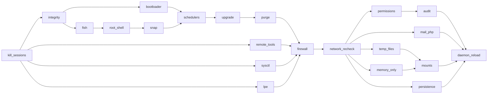

# paranoia

A Linux hardening, audit and cleanup tool for Ubuntu, written in Rust. It is a port of `megascript.sh` that fixes the weaknesses of the original: it does not trust `PATH`, it audits persistence mechanisms the script never looked at, and it ships as a single static binary.

> [!WARNING]
> Paranoia changes networking, passwords, firewall rules, cron/timers, mounts and packages. Take a snapshot and run `sudo ./paranoia --no-apt --no-passwords` on a throwaway VM first. Do not first-run it on your only machine.

## Contents

- [paranoia](#paranoia)
  - [Contents](#contents)
  - [Features](#features)
  - [Install](#install)
  - [Usage](#usage)
  - [What it does](#what-it-does)
  - [Configuration](#configuration)
  - [Building](#building)
  - [Project layout](#project-layout)
  - [Behaviour to know about](#behaviour-to-know-about)
  - [Improvements over megascript.sh](#improvements-over-megascriptsh)
  - [Status and roadmap](#status-and-roadmap)

## Features

- Single static musl binary. Only dependencies are `libc` and `md-5`.
- Absolute-path execution with a cleared environment, so a poisoned `PATH` or `LD_PRELOAD` is irrelevant.
- Self-elevates (`sudo`, then `pkexec`) and re-executes from an in-memory file descriptor.
- Rootkit and keylogger pre-flight checks run before any password is typed.
- Parallel, dependency-aware step runner with a progress line, ETA and a saved final report.
- Audits ssh, sudo, `authorized_keys`, accounts, PAM, capabilities and persistence points.
- Optional `--strict` verification against freshly downloaded signed packages, and `--watch` re-checking.

## Install

| Method | Command | Needs `chmod`? |
| --- | --- | --- |
| `.deb` | `sudo apt install ./paranoia_*.deb` (postinst runs the tool) | No |
| Tarball | `tar xzf paranoia.tar.gz && sudo ./paranoia` | No |
| One-liner | `curl -fsSL <URL> \| sudo sh` (pinned SHA-256, see `packaging/install.sh`) | No |
| Bare binary | `chmod +x paranoia && sudo ./paranoia` | Yes |

No OS runs a downloaded file by itself, and a bare download has no exec bit. The `.deb`, tarball and stub all avoid the `chmod` step.

Before using the one-liner, set `URL` and `SHA256` in `packaging/install.sh` (or export `PARANOIA_URL` and `PARANOIA_SHA256`). The stub refuses to run unpinned.

## Usage

```bash
sudo ./paranoia [--no-apt|--report-only] [--no-passwords] [--passwords-fd=N] [--strict] [--watch[=SECS]]
```

| Flag | Effect |
| --- | --- |
| `--no-apt`, `--report-only` | Make no package changes. Repairs that need apt are logged as `REPORT-ONLY`. |
| `--no-passwords` | Skip the password prompts. |
| `--passwords-fd=N` | Read the user password, then the root password (one per line) from fd `N`. |
| `--strict` | Verify critical packages against freshly downloaded signed `.deb` files. Needs network and apt lists. |
| `--watch[=SECS]` | After the run, re-check every `SECS` seconds (default 60) and print only new findings. |
| `-h`, `--help` | Show usage. |

Password prompts read from `/dev/tty`. With no tty, use `--passwords-fd` or `--no-passwords`.

Logs and the final report are written to a tmpfs work directory (`main.log`, `final_report.txt`) and disappear on reboot. If your terminal drops, the run continues; reattach with `tail -f <workdir>/main.log`.

## What it does

Startup order:

1. Audit and disable unpackaged apt hooks (before any apt call).
2. Fix the network, stop Ubuntu's own apt timers, disable apt retries.
3. Reset shell profiles for every local account.
4. Pre-flight keylogger and rootkit checks, with an abort prompt on findings.
5. Prompt for the new user and root passwords.
6. Run the step graph below.



`strict` (with `--strict`) runs after `purge`, before `firewall`. Steps that use apt share one lock.

## Configuration

All site constants live in `src/config.rs`: the expected IP, gateway, DNS, AD server and names, allowed inbound TCP ports, package lists, kernel modules to block, and so on. Edit them and rebuild. A wrong value for your lab will break networking, so review them first.

## Building

Requires a Rust toolchain.

```bash
rustup target add x86_64-unknown-linux-musl
cargo build --release   # target/x86_64-unknown-linux-musl/release/paranoia
./build.sh              # binary, tarball, SHA256SUMS and .deb in dist/ (uses cargo-deb)
```

## Project layout

```text
paranoia/
  Cargo.toml, .cargo/config.toml   musl, static
  build.sh                         release build and packaging
  packaging/                       postinst, install.sh (curl stub)
  src/
    main.rs        args, signals, elevate, memfd re-exec, startup order
    config.rs      site constants
    cmd.rs         safe exec (absolute path, env_clear, timeout)
    ctx.rs         shared state, warnings, log, owned-path index
    pkg.rs         native dpkg status and md5sums verification, apt wrappers
    runner.rs      parallel scheduler, progress line, final report
    prompt.rs      hidden tty password prompts
    preflight.rs   keylogger and rootkit checks
    util.rs        fs helpers (chattr, xdev walk, statoverride lock)
    watch.rs       --watch loop
    steps/         accounts, apt, audit, firewall, misc, mounts, network,
                   perms, persist, reload, sched, shell, strict, sysctl, temp
```

## Behaviour to know about

- **Egress is not filtered.** The firewall drops inbound by default and allows the configured ports; the output policy is `accept`.
- **Schedulers are removed.** cron, at, anacron and all timers are archived under root's home and masked, except `logrotate`, `systemd-tmpfiles-clean` and `fstrim`.
- **`/tmp` becomes a `noexec` tmpfs on next boot**, and `/proc` gets `hidepid=2`. Test installers that run from `/tmp`.
- **Kernel LPE mitigations are temporary.** Module blocks live in `/run/modprobe.d` and clear on reboot.
- **`--watch` re-runs the network fix** each cycle, undoing manual network changes.
- **Audits mostly report.** Automatic fixes are limited to locking empty-password accounts and renaming unpackaged apt hooks to `*.disabled`.

## Improvements over megascript.sh

| Area | megascript.sh | paranoia |
| --- | --- | --- |
| Trust | Calls tools via `PATH`, network fix before any check | Absolute paths, cleared env, static binary |
| Package verification | `dpkg --verify` only (trusts local md5sums) | Adds `--strict` against downloaded signed packages |
| apt | Hooks and keys unaudited, `grep ubuntu.com` matches `evilubuntu.com` | Hooks audited first, real host matching |
| Rootkit hints | Process heuristics only | Adds hidden-PID diff, `/sys/module` vs `/proc/modules`, taint flag |
| `authorized_keys` | Excluded and never inspected | Ownership fixed, every key listed, options flagged |
| ssh, sudo, accounts | `chmod` only | `sshd -T` checks, sudoers content, UID 0, empty hashes |
| Persistence | Partial | systemd drop-ins, `ld.so.conf.d`, udev, `rc.local`, python `.pth`, and more |
| Sessions | `who` (forgeable) and ttys | `/proc` scan incl. ttyless sshd, `ssh -N`, tmux |
| Memory-only procs | Deleted and memfd binaries | Also unpackaged binaries in `/tmp`, `/dev/shm`, `/home` |
| Profiles | root and `sysadmin` | Every local uid 0 or >= 1000 account |
| Binary lockdown | `chmod 000` (reverted by upgrades) | `dpkg-statoverride` |
| Timers | All masked | Keeps logrotate, tmpfiles-clean, fstrim |
| Mounts | None | `noexec,nosuid,nodev`, `hidepid=2` |
| Lifetime | One shot | Optional `--watch` |

## Status and roadmap

The code compiles. It has not yet been run end to end.

- [x] Port of every `megascript.sh` step
- [x] Audits, persistence sweep, mount hardening, `--strict`, `--watch`
- [x] Packaging (`.deb`, tarball, curl stub, `--passwords-fd`)
- [ ] Test on Ubuntu 22.04 and 24.04 VMs with `--no-apt`, then a full run
- [ ] Persistent (non-temporary) kernel module blocking option
- [ ] Extra sysctl knobs (`kexec_load_disabled`, `perf_event_paranoid`, `io_uring_disabled`, userns limits) and a post-apply verify
- [ ] `--lock-etc` (`chattr +i /etc`), deliberately not automatic because it breaks apt and password changes
